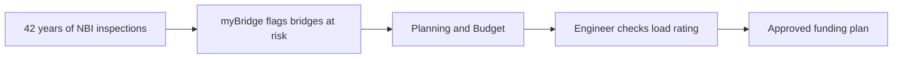

# myBridge

**Every bridge. Know when it needs you.**

myBridge helps bridge owners find which bridges are likely to need major repair within the next 5 years, early enough to plan a rehabilitation instead of being forced into an urgent, expensive replacement. Licensed Engineer in-the-loop verify the suggestions by submitting appropriate documents.
---

## The problem

Bridge owners manage thousands of bridges but only have budget for a fraction of them each year. Inspections already exist in the FHWA National Bridge Inventory (NBI) — what owners lack is a clear, plain-English answer to:

> Which bridge needs attention first, what happens if we wait, and what should we do next?

## What myBridge does

myBridge has three simple dashboards, reached from one minimal home page:

| Dashboard | What it's for |
|---|---|
| **Explore Bridges** | Search a road, river, town, or county. See bridges on a map and read a short **Overview** for any bridge. |
| **Planning & Budget** | Move a budget slider and see how many of the most urgent bridges could be started in the next 5 years. |
| **Engineer Check** | An engineer verifies a suggested bridge with a real load rating before it can be approved for the funding plan. |

No roles, no raw data fields, no model jargon in the main experience. Technical details are tucked inside an "Engineer technical details" expander for engineers who want them.

> **A note on words:** "Poor" means a bridge needs major repair. It does **not** mean it is unsafe to cross. Unsafe bridges are closed through a separate process.

## How to use myBridge

```
1. Find            2. Read Overview       3. Plan              4. Engineer Check
Search or tap  ->  Condition today    ->  Choose a budget  ->  Upload load rating,
a pin on the map   and outlook in         and see which      verify the numbers,
                   plain English          bridges start      then approve
                                          first
```

## How a decision is made



myBridge suggests. A licensed engineer decides. Nothing is auto-approved.

## How Meta Llama is used

**Llama explains. XGBoost predicts. A licensed engineer decides.**

- **Prediction:** XGBoost (trained offline) scores each bridge's chance of needing major repair within 5 years.
- **Explanation:** Meta **Llama 4 Scout** (`@cf/meta/llama-4-scout-17b-16e-instruct`, served via Cloudflare Workers AI) turns one bridge's real inspection numbers into a short, plain-English **Overview**.
- **Verification:** In Engineer Check, the engineer uploads a load-rating result from their normal software (e.g. AASHTOWare BrR), verifies the numbers, and only then can approve the bridge.

Llama never invents numbers and never approves a bridge. The app sends **one bridge at a time** as structured data — never the full dataset. If the Llama API is unavailable, the app falls back to a built-in plain-English summary so the demo never breaks.

## Model Card

| | Markov baseline (industry standard) | myBridge (XGBoost) |
|---|---:|---:|
| Validation AUC (2016–2018) | 0.816 | **0.900** |
| Test AUC (2019–2020) | 0.806 | 0.794 |
| Validation PR-AUC | — | 0.331 |
| Validation Recall @ 0.3 | — | 0.751 |

**Setup, reported honestly:**
- Data: FHWA NBI inspections, 1983–2025. Labeled training rows 2000–2020.
- Target: a bridge that is **not already Poor** reaches Poor (minimum component condition ≤ 4) **within 5 years**.
- Split: temporal only (train 2000–2015 · validate 2016–2018 · test 2019–2020). No random split.
- Bridges that were rehabilitated or reconstructed in the window are censored — the model never learns that bridges "heal themselves."
- The test window (2019–2020) drifts versus validation; that drop is shown, not hidden. The final model is retrained on all labeled 2000–2020 rows (120,562 rows, 1,200 trees) for the app.
- Current app snapshot: **11,250 bridges** — 1,489 need major repair now, 2,054 could within 5 years if nothing is done.
- Leakage is excluded by design: `CAT10 Bridge Condition` and `Total Project Cost` are never used as features.

## Data

Source: FHWA National Bridge Inventory via InfoBridge exports, 1983–2025.

Features investigated include condition history (deck, superstructure, substructure, channel), effective age and years since reconstruction, traffic and truck share, span geometry and deck area, and material, design, owner, county, and scour category. Weight capacity (operating/inventory rating) is shown for engineers, not used to predict deterioration.

The raw file (`data_NBI.csv`, ~102 MB) is **not** in this repo — it's excluded by `.gitignore`. The app runs entirely on the small derived file `data/app_data.parquet`.

## Tech stack

- **Python, Streamlit, Plotly** — app and map
- **XGBoost, scikit-learn, pandas** — deterioration model (offline, in `train_mybridge.py`)
- **Meta Llama 4 Scout** — plain-English Overviews
- **Streamlit Cloud** — deployment

## Run it locally

```powershell
cd mybridge
.\.venv\Scripts\python.exe -m pip install -r requirements.txt
.\.venv\Scripts\python.exe -m streamlit run app.py
```

Open http://localhost:8501

For the Llama Overview, add your own provider key locally in `.streamlit/secrets.toml` (never commit this file):

```toml
LLAMA_API_KEY = "your_key_here"
LLAMA_BASE_URL = "https://api.cloudflare.com/client/v4/accounts/YOUR_ACCOUNT_ID/ai/v1"
LLAMA_MODEL = "@cf/meta/llama-4-scout-17b-16e-instruct"
```

The app also runs without a key, using the built-in summary fallback.

## Reproduce the model

```powershell
# place the raw export as data_NBI.csv in the project root (local only)
.\.venv\Scripts\python.exe train_mybridge.py
# outputs: model/xgb_poor5yr.pkl, model/features.json, model/metrics.json, data/app_data.parquet
```

## Repo structure

```
myBridge/
  app.py                  # Streamlit app (3 dashboards + guide)
  train_mybridge.py       # offline training pipeline
  requirements.txt
  data/app_data.parquet   # latest-year bridges + predictions (app input)
  model/xgb_poor5yr.pkl   # frozen XGBoost v3
  model/metrics.json      # Markov vs XGBoost results
```

## Limitations

- Predictions estimate **condition deterioration only** — not safety, and not a substitute for inspection or load rating.
- 2019–2020 test performance shows real temporal drift; treat the 5-year outlook as planning guidance, not a date.
- Planning costs are early estimates from deck area. An engineer confirms scope and cost for every bridge.
- Culvert-only structures without deck/superstructure/substructure ratings are excluded.

## License

MIT — see `LICENSE`.

## Acknowledgements

Data: FHWA National Bridge Inventory. Predictions are planning support only; final programming decisions rest with the asset owner and a licensed professional engineer.
